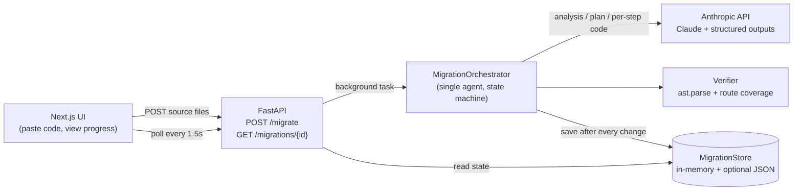
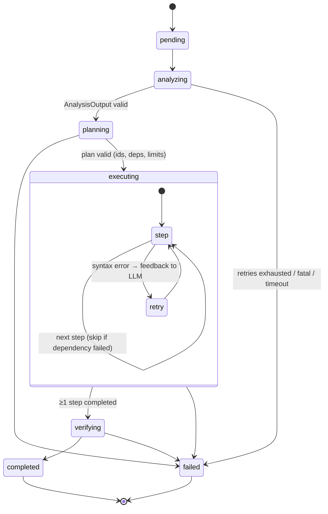

# Migration Workflow Agent

A small AI-powered app that migrates **Express.js** code to **FastAPI (Python)**. It uses a
single agent that runs an **analyze → plan → execute → verify** workflow with Claude.
I built it for **Lab 03 of Taller Academy**.

You paste Express.js files and the agent:
1. finds the endpoints, dependencies and migration risks,
2. writes a structured migration plan,
3. generates FastAPI code step by step, and
4. checks the result and produces a verification report.

The UI shows the original and migrated code side by side.

## Learning objectives

- Build an **agent with plan-and-execute orchestration** that uses explicit state transitions, without an agent framework.
- Use **structured LLM outputs** validated with Pydantic, and treat model output as untrusted.
- Make an LLM workflow reliable with **bounded retries, timeouts, input limits and clear error handling**.
- Add **deterministic verification** (AST checks) on top of generated code, and be honest about what it doesn't prove.
- Keep the LLM behind a small interface so the workflow can be **tested without network calls**.

## Tech stack

| Layer | Technology |
|---|---|
| Backend | Python 3.11+, FastAPI, Pydantic v2, Uvicorn |
| LLM | Anthropic API (Claude, `claude-opus-5-5` by default) via the official `anthropic` Python SDK |
| Frontend | Next.js 15 (App Router), React 19, TypeScript |
| Tests / lint | pytest, Ruff, `tsc` |
| Deployment targets | Railway or Render (backend), Vercel (frontend) |

The only supported migration path is Express.js → FastAPI.

## Architecture



### Four-phase agent workflow



The workflow lives in `backend/app/orchestrator.py`. `ALLOWED_TRANSITIONS` in `models.py` is the single source of truth, and any other transition raises an error.

| Phase | What happens | Output |
|---|---|---|
| 1. Analysis | One LLM call that lists the endpoints (with full mount paths), npm dependencies with Python equivalents, and migration concerns | `AnalysisOutput` |
| 2. Planning | One LLM call that produces ordered steps (`id`, `description`, `depends_on`, `target_file`). Code then checks the plan: ids are unique, a step may only depend on earlier steps (so there are no cycles), there is a step limit, and target paths are safe | `PlanStep[]` with statuses |
| 3. Execution | One LLM call per step. The prompt includes the step's original files and the files generated so far. Each result is syntax-checked with `ast.parse`. If the code is invalid, the error goes into the retry prompt. A failed step marks the steps that depend on it as `skipped` and does not abort the run | `MigratedFile[]` |
| 4. Verification | Deterministic checks with no LLM: syntax of every file, each analysed endpoint matched to a FastAPI route decorator, failed or skipped steps, TODO markers, and whether a `FastAPI()` instance exists | `VerificationReport` |

**Key decisions**
- **One agent, code-driven orchestration.** Code decides the control flow and the LLM fills in each phase. This is easier to reason about and test than letting the model choose its own tools, and it is enough for a lab.
- **Structured outputs + Pydantic.** Every call uses `client.beta.messages.parse(output_format=<Model>)`. The result is validated again with Pydantic, and business rules (like plan validity) are checked in code. `refusal` and `max_tokens` stop reasons count as recoverable errors. Server-side refusal fallback (`fallbacks="default"`) is enabled.
- **Bounded everything.** There are `MAX_ATTEMPTS_PER_CALL` retries per LLM call, at most `MAX_PLAN_STEPS` steps, a wall-clock `MIGRATION_TIMEOUT_S` per run, a per-request timeout, input size limits, and a cap on concurrent migrations (HTTP 429 when exceeded). Auth and bad-request errors are fatal and are not retried.
- **Polling over SSE.** Polling is simpler, works through any proxy, and suits jobs that take minutes. The UI polls every 1.5 s.
- **Testable seam.** The orchestrator depends on an `LLMClient` protocol. Tests inject a fake, while the app always uses `AnthropicLLM`.

**Safety**
- Submitted code is **never executed**. It is only sent to the LLM as tagged data, and the prompt tells the model not to follow instructions inside it. Generated code is only *parsed* (`ast.parse`) and is never imported or run. A test checks this.
- Original inputs (`source_files`) and generated code (`migrated_files`) are kept in separate fields.
- File paths must be relative with no `..`. Size limits are enforced before any LLM call.
- Secrets come only from environment variables. `.env` is git-ignored.

## Run locally

Prerequisites: Python 3.11+ and Node 20+.

```bash
# Backend
cd backend
python3 -m venv .venv
.venv/bin/pip install -r requirements-dev.txt
cp .env.example .env            # then set ANTHROPIC_API_KEY
./run_dev.sh                    # http://localhost:8000  (docs at /docs)

# Frontend (second terminal)
cd frontend
cp .env.example .env.local      # NEXT_PUBLIC_API_URL=http://localhost:8000
npm install
npm run dev                     # http://localhost:3000
```

In the UI, click **Load sample**, then **Start migration**.

### API

```bash
curl -X POST localhost:8000/migrate -H 'Content-Type: application/json' -d '{
  "source_framework": "express", "target_framework": "fastapi",
  "files": [{"path": "server.js", "content": "const express = require(\"express\"); ..."}]
}'
# → 202 {"id": "…", "status": "pending"}

curl localhost:8000/migrations/<id>
# → status, analysis, plan (with step statuses), migrated_files, verification, errors, events
```

## Environment variables

Backend (`backend/.env.example`):

| Variable | Default | Purpose |
|---|---|---|
| `ANTHROPIC_API_KEY` | — (required) | Anthropic API key |
| `ANTHROPIC_MODEL` | `claude-opus-5-5` | Model used for all phases |
| `LLM_EFFORT` | `medium` | `low`/`medium`/`high`/… effort level |
| `LLM_MAX_TOKENS` / `LLM_REQUEST_TIMEOUT_S` | `16000` / `180` | Per-call limits |
| `MAX_FILES` / `MAX_FILE_BYTES` / `MAX_TOTAL_BYTES` | `10` / `50000` / `150000` | Input limits |
| `MAX_PLAN_STEPS` / `MAX_ATTEMPTS_PER_CALL` | `10` / `3` | Workflow bounds |
| `MIGRATION_TIMEOUT_S` / `MAX_CONCURRENT_MIGRATIONS` | `900` / `3` | Run limits |
| `CORS_ORIGINS` | `http://localhost:3000` | Comma-separated allowed origins |
| `DATA_DIR` | unset | If set, JSON snapshots of each migration are written here |

Frontend: `NEXT_PUBLIC_API_URL` (the backend URL).

## Tests

```bash
cd backend
.venv/bin/pytest -q            # unit + API + e2e (fake LLM, no key or network needed)
.venv/bin/ruff check . && .venv/bin/ruff format --check .

cd frontend
npm run lint                   # tsc --noEmit
npm run build
```

The backend tests cover the state transitions, retries with syntax-error feedback, skipping steps whose dependencies failed, plan validation, fatal vs. recoverable errors, deadlines, input limits and path traversal, persistence after a restart, the verifier (including a no-execution check), and the real `AnthropicLLM` request shape against a mocked HTTP transport. `test_api.py::test_e2e_smoke_migrate_sample_and_poll` runs the whole HTTP flow end to end, with a fake LLM.

**Real end-to-end smoke test (uses your API key and costs a few cents to a few dollars):**

```bash
cd backend && ./run_dev.sh &          # with ANTHROPIC_API_KEY set
python3 scripts/smoke_test.py          # from repo root; exits 0 if completed + verification passed
```

## Sample

- Input: `samples/express-users/`. An Express app with a `/users` router (list with `?limit`, get, create, delete), JSON body parsing, a logging middleware, an error handler and `/health`.
- Real run: one end-to-end run with the Anthropic API completed all four phases in about 75 s. It produced 3 files (`app/models.py`, `app/routers/users.py`, `app/main.py`), each passing syntax validation, and matched 5 of 5 endpoints.
- Expected output: `samples/expected-fastapi/`. A **hand-written reference** showing what a good migration looks like, with notes on behaviour differences (for example, validation errors return 422 instead of 400). The app does not use it. The LLM generates new code every run, and a test checks that the verifier accepts this reference.

## Limitations

- **Verification is static.** It checks syntax and route coverage only. It does **not** prove runtime or behavioural equivalence, and it does not check imports, types or status codes.
- Route matching assumes prefixes are declared on `APIRouter(prefix=...)`, which the prompt asks for. Prefixes added in `include_router(prefix=...)` are only matched by suffix and are flagged as warnings.
- **Persistence is minimal.** State lives in process memory, with optional JSON snapshots. It works with one process or worker only. Runs interrupted by a restart are marked `failed`. On Railway or Render the disk is ephemeral unless you attach a volume.
- Jobs run in FastAPI background threads. There is no queue, and a run can't be cancelled.
- There is no authentication, so anyone with the URL can spend your API credits. Keep deployments private or add auth before sharing them.
- Only one framework pair is supported. Input is pasted text only (no uploads or repos).
- LLM output is non-deterministic. Two runs on the same input can produce different code.

## Deployment

**Backend → Railway**
1. Create a new service from the GitHub repo and set **Root Directory** to `backend`.
2. `backend/railway.json` sets the start command (`uvicorn app.main:app --host 0.0.0.0 --port $PORT`) and the `/health` check. Python 3.12 is pinned in `.python-version`.
3. Set the variables `ANTHROPIC_API_KEY` and `CORS_ORIGINS=https://<your-vercel-app>.vercel.app`.

*Alternative: Render.* Use `render.yaml` at the repo root as a Blueprint, then set `ANTHROPIC_API_KEY` and `CORS_ORIGINS` in the dashboard.

**Frontend → Vercel**
1. Import the repo and set **Root Directory** to `frontend`. The framework is detected as Next.js.
2. Set `NEXT_PUBLIC_API_URL=https://<your-backend-host>`, then redeploy (the value is baked in at build time).

## Project layout

```
backend/app/
  main.py          API routes, input limits, app factory
  orchestrator.py  state machine + phases + retries/deadline
  llm.py           AnthropicLLM (structured outputs, error mapping)
  prompts.py       per-phase prompts
  verification.py  ast-based syntax + route coverage checks
  models.py        Pydantic models (API, LLM schemas, state)
  store.py         in-memory store + optional JSON snapshots
backend/tests/     pytest suite (fake LLM)
frontend/app/      single-page UI
samples/           Express input + hand-written expected FastAPI output
scripts/           real-API smoke test
```
